<!-- ===================== BANNER ===================== -->

  

<!-- ===================== TERMINAL ===================== -->

  

<!-- ===================== PROFILE ===================== -->
<table>
  <tr>
    <td width="55%" valign="top">
      <h2>Deskripsi</h2>
      Seorang <b>Pentester</b> yang tertarik pada
      keamanan siber, analisis kerentanan,
      dan eksploitasi sistem untuk membangun
      pertahanan lebih kuat.
    </td>
    <td width="45%" align="center" valign="middle">
      
    </td>
  </tr>
</table>

<!-- ===================== SKILLS ===================== -->
## 🛡️ Keahlian Pentest

  
  
  
  
  
  

<!-- ===================== TOOLS ===================== -->

## ⚙️ Tools & Frameworks

  
  
  
  
  
  
  

<!-- ===================== CERTIFICATES ===================== -->
## 🏆 Certifications & Achievements

<table>
  <tr>
    <td width="50%" align="center">
      
    </td>
    <td width="50%" align="center">
      
    </td>
  </tr>
</table>

<!-- ===================== QUOTE ===================== -->

  <i>
    "kerentanan yang sebenarnya ada
    pada manusia itu sendiri."
  </i> 
  #human eror

<!-- ===================== PACMAN ===================== -->

<picture>
  <source media="(prefers-color-scheme: dark)" srcset="https://raw.githubusercontent.com/Frist131/Frist131/output/pacman-contribution-graph-dark.svg">
  <source media="(prefers-color-scheme: light)" srcset="https://raw.githubusercontent.com/Frist131/Frist131/output/pacman-contribution-graph.svg">
  
</picture>

<!-- ===================== SOCIAL ===================== -->
## 🌐 Social Media

  
  
  

